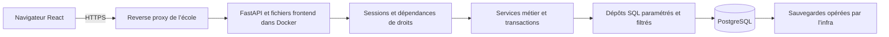
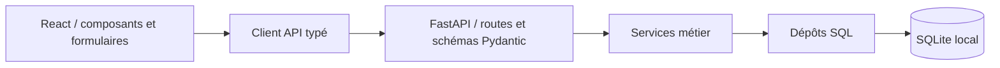

# Architecture de Circular

## Décision 004 — espaces de travail et onboarding, 28 octobre 2026

Les tables `workspaces` et `workspace_members` ajoutent un conteneur aux projets. Une adhésion est propriétaire, membre ou invité limité aux projets explicitement partagés. La migration `005_workspaces.sql`, propre à chaque dialecte, affecte les anciennes données à un espace personnel en conservant la visibilité privée des projets. Le backfill est transactionnel ; il est aussi utilisé par l’import SQLite et l’attribution des données historiques.

La création d’espace est une transaction qui crée l’adhésion propriétaire, le premier projet et les trois tickets d’accueil demandés. Les étapes facultatives s’appuient sur le profil du compte et l’état d’onboarding de son adhésion. Les invitations à une adresse et les liens expirent au bout de sept jours ; le backend ne stocke que l’empreinte du secret d’un lien. Les liens restent soumis à une connexion et à une acceptation explicite.

Le navigateur envoie `X-Workspace-Id`, capturé au départ de chaque requête. Le serveur valide l’adhésion et filtre les ressources de cet espace, y compris les accès directs, références d’étiquettes, préférences, vues et modèles. Les anciennes requêtes sans cet en-tête restent compatibles et soumises aux droits du compte ; omettre l’en-tête ne rétablit pas un accès révoqué. Les mutations PostgreSQL conservent un verrou sur l’adhésion sélectionnée pendant leur transaction. Côté React, un changement d’espace remonte l’application et empêche qu’une réponse tardive ou un enregistrement de réglages en attente ne contamine l’espace suivant.

La sélection de l’espace fait partie de l’URL (`?workspace=<slug>`), les liens d’invitation utilisent un fragment et les données métier restent en base. Les invitations n’envoient pas d’email. GitHub/Slack sont des présentations explicitement inactives, conformément à la demande ; aucun accès à ces services n’est effectué.

Le runtime Docker passe à l’image officielle Python 3.12/Alpine 3.24 figée par digest. Le [diagnostic du scan](container-security.md) explique le changement de distribution et les vérifications associées.

## Décision 003 — service multi-utilisateur déployable, 28 octobre 2026

Cette décision complète et remplace les hypothèses mono-utilisateur/loopback des décisions historiques ci-dessous. Le découpage React → routes FastAPI/Pydantic → services → dépôts SQL est conservé. Les opérations synchrones utilisent les handlers FastAPI synchrones et leur pool de threads ; aucune opération bloquante de base n’est ajoutée à un handler async.

Les services métier sont construits par requête avec l’identifiant du compte authentifié. Le navigateur ne fournit jamais l’identité utilisée pour contrôler l’accès. Un projet possède un propriétaire ; `project_members` accorde l’accès collaboratif après acceptation d’une entrée `project_invitations`. Les requêtes de liste et d’accès direct vérifient ce périmètre. Préférences, vues, modèles et favoris sont personnels. Les auteurs des commentaires et du journal sont enregistrés côté serveur.

`Database` conserve une connexion par unité de travail. Le pilote PostgreSQL psycopg et SQLite présentent une interface de dépôt commune ; les paramètres sont toujours transmis séparément du SQL. Les particularités de pilote (paramètres, alias et identifiants générés) restent dans `db/postgres.py`. Les SQL métiers utilisent des expressions portables. Les migrations PostgreSQL ont leurs fichiers explicites dans `db/migrations/postgres`, et un verrou consultatif sérialise les migrations au démarrage. Les mises à jour de tickets/projets et les réglages personnels utilisent des verrous en base pour éviter d’écraser des champs lors de mises à jour concurrentes.

Les sessions sont des secrets aléatoires de 256 bits : le cookie HttpOnly contient la valeur, la base ne conserve que son empreinte. Le CSRF associé reste dans la mémoire du frontend ; chaque mutation authentifiée le contrôle. Argon2id protège les mots de passe, et les compteurs de tentatives/expirations sont partagés en base. Une révocation d’accès est contrôlée au serveur, indépendamment des boutons masqués par l’interface.

L’image multi-stage compile React puis exécute Python sous UID 10001 avec système de fichiers en lecture seule. La configuration publique vient de l’environnement ; la connexion PostgreSQL est lue dans un secret monté. Le mode production exige PostgreSQL et une origine HTTPS, contrôle Host/Origin et émet les en-têtes de protection. Le reverse proxy de l’école assure la terminaison TLS ; seuls ses IP/CIDR explicitement configurés peuvent fournir l’adresse du client à Uvicorn.

Les anciennes données SQLite restent intactes et sans propriétaire jusqu’à une attribution opérateur explicite. L’import vers une base PostgreSQL vide conserve les identifiants et ne transporte pas les sessions. Les données de démonstration ne sont jamais créées automatiquement, et leur commande est refusée en production.

Voir [déploiement](deployment.md), [validation actuelle](production-validation.md) et [licence](../LICENSE). Références techniques : [secrets Compose](https://docs.docker.com/compose/how-tos/use-secrets/), [démarrage avec healthcheck](https://docs.docker.com/compose/how-tos/startup-order/), [paramètres psycopg](https://www.psycopg.org/psycopg3/docs/basic/params.html), [sessions OWASP](https://cheatsheetseries.owasp.org/cheatsheets/Session_Management_Cheat_Sheet.html), [hachage des mots de passe OWASP](https://cheatsheetseries.owasp.org/cheatsheets/Password_Storage_Cheat_Sheet.html).

## Décisions historiques de la version locale

## Décision 001 — monolithe local en couches

Statut : retenue pour la v1 et conservée pour l’extension issue de l’audit du 16 octobre 2026, à la demande de l’utilisateur (FastAPI).

Le point de composition construit et injecte les dépendances. Les routes traitent le protocole HTTP et la validation des entrées. Les services appliquent les règles métier : identifiant stable, existence des relations, suppression d’un projet vide uniquement, mises à jour atomiques. Les dépôts encapsulent les requêtes SQL et la transformation des lignes. Les migrations sont versionnées séparément. Les composants React n’exécutent jamais de SQL et passent par `src/api.ts`.

Ce découpage permet de faire évoluer le transport HTTP ou la persistance sans déplacer les règles dans l’interface. Une seule application Python suffit au périmètre mono-utilisateur ; microservices, serveur de messages et cache distribué ajouteraient de l’exploitation sans besoin fonctionnel.

## Décision 002 — SQLite et transactions explicites

Statut : retenue.

Base fichier, clés étrangères, mode WAL et transactions pour les écritures qui touchent plusieurs tables. Un compteur de projet alloue les identifiants sans réutiliser un numéro supprimé. L’identifiant ne change pas lorsqu’un ticket change de projet. La suppression d’un ticket supprime ses commentaires et liens d’étiquettes. Un projet non vide est protégé.

L’API synchrone de la bibliothèque standard `sqlite3` est adaptée aux petits volumes locaux. Les routes qui l’utilisent sont exécutées dans le pool de threads de FastAPI, pas directement dans sa boucle asynchrone. Chaque unité de travail possède sa connexion. Ce choix évite un ORM et une dépendance asynchrone supplémentaires ; les migrations et requêtes restent explicites. Pour une version multi-utilisateur, la stratégie de concurrence et le stockage seraient à réévaluer.

## Décision 003 — serveur local et interface autonome

Statut : retenue.

Le serveur écoute sur loopback. En production locale il sert le build React et l’API depuis la même origine. En développement, Vite relaie `/api` vers FastAPI. Les ressources et polices restent locales, la politique CSP limite les ressources à l’application. Aucun compte, secret, requête Linear ou service cloud n’est nécessaire. Le contrôle Host/Origin limite les accès accidentels depuis des sites tiers ; cette application n’est pas conçue pour une exposition publique.

## Décision 004 — tests sur la vraie persistance

Statut : retenue.

Les tests API utilisent FastAPI TestClient et des fichiers SQLite temporaires. Les tests navigateur lancent un vrai backend avec une base isolée et Chrome déjà installé. Ils vérifient les parcours par l’interface, le redémarrage du processus avec le même fichier, les erreurs et les requêtes réseau. Les données de démonstration ne sont pas utilisées comme oracle et ne sont jamais réinjectées automatiquement.

Références : [organisation des applications FastAPI](https://fastapi.tiangolo.com/tutorial/bigger-applications/), [exécution des routes synchrones](https://fastapi.tiangolo.com/async/), [sqlite3 Python](https://docs.python.org/3/library/sqlite3.html).

## Décision 005 — préférences et vues dans le même serveur local

Statut : implémentée le 16 octobre 2026.

`api/preferences.py`, `schemas/preferences.py`, `services/preferences.py` et `repositories/preferences.py` suivent les mêmes couches que le domaine projets/tickets. Le service valide l’existence des projets et étiquettes référencés par les filtres et les modèles. Le schéma Pydantic borne les champs et les listes et rejette les champs inconnus. Le stockage JSON des réglages est validé à cette frontière ; aucun SQL arbitraire ni expression de filtre libre n’est accepté.

`workspace_settings` contient une ligne pour l’utilisateur local : préférences générales, filtres et affichage courant. `saved_views` conserve des instantanés nommés des filtres/affichages ; ils ne sont remplacés qu’à la demande. Les modèles sont normalisés dans `issue_templates` et `template_labels`, avec un projet facultatif. Les favoris sont un booléen du ticket. Aucune de ces données n’est déléguée au stockage du navigateur.

Côté React, `useSettings` charge les préférences avant les tickets et sérialise les sauvegardes pour éviter qu’une réponse lente écrase un réglage plus récent. L’interface applique le nouvel affichage immédiatement mais conserve une erreur visible et une action de réessai si sa sauvegarde échoue ; elle ne présente pas un échec comme une persistance réussie. Les préférences générales restent un formulaire à sauvegarde explicite. La suppression d’un projet vide ou d’une étiquette nettoie aussi leurs références dans les filtres/vues, dans la transaction métier. Les contraintes SQLite retirent les associations de modèles supprimées.

Les filtres et le tri des tickets sont exécutés dans le dépôt SQLite. Les valeurs de filtre sont paramétrées et les colonnes/directions de tri viennent de listes autorisées. Le frontend groupe le résultat trié pour la liste ; le tableau conserve les colonnes fixes de statut afin que le déplacement corresponde toujours à un changement métier clair.

## Décision 006 — extension migrée sans réinitialisation de la base

Statut : implémentée avec `002_preferences_workflows.sql`.

Le constructeur `Database` applique les migrations manquantes, également accessibles par `npm run migrate`. Chaque fichier SQL est exécuté dans une transaction explicite puis inscrit dans `schema_migrations`. L’idempotence appartient au mécanisme de versions : le script `ALTER TABLE` ne doit pas être exécuté manuellement plusieurs fois. Un redémarrage ne remet pas les tables à zéro et ne lance pas le seed.

La migration ajoute les tables des préférences, vues, modèles et activités, les colonnes d’échéance des projets/tickets, le statut de projet, le favori de ticket et la description d’étiquette. Les données antérieures sont conservées. Les projets existants prennent le statut `planned`, les dates restent nulles et les favoris sont désactivés. Les clés étrangères assurent les cascades des associations et la suppression des commentaires/activités d’un ticket. Le projet d’un modèle devient nul lorsqu’un projet vide est supprimé.

Une sauvegarde facultative du fichier SQLite peut être faite avant mise à jour, backend arrêté, comme décrit dans le README. Il n’est nécessaire ni d’effacer la base ni de réinjecter les démonstrations.

## Décision 007 — historique transactionnel et actions locales

Statut : implémentée le 16 octobre 2026.

Création et modification de ticket, ainsi que création/modification/suppression de commentaire, écrivent un événement dans `issue_activity` avec la même connexion et dans la même transaction que la mutation. Un PATCH sans changement réel du ticket ne produit pas d’événement. Le journal décrit l’opération et les champs modifiés ; il ne stocke pas les versions successives de leur contenu. Il n’est pas rétroactif et ne constitue pas un système de restauration. La suppression du ticket supprime aussi son journal.

La duplication alloue un nouvel identifiant par le compteur existant du projet, copie les champs enregistrés et les étiquettes, et crée un événement de création propre à la copie. Les commentaires, activités antérieures et le favori ne sont pas copiés. Une échéance est une date civile ISO validée, sans composante horaire ; les horodatages d’activité restent en UTC.

Les liens de ticket sont des paramètres d’URL locaux (`?issue=<id>`, avec `mode=page` facultatif). Ils ouvrent le même composant de détail que la liste. La palette interroge uniquement l’API locale et expose des commandes réellement raccordées. Copier un lien utilise l’API presse-papiers du navigateur et affiche son éventuel refus. Cette extension n’introduit aucun compte, service distant, package supplémentaire ni modification de configuration globale.

Voir [la spécification fonctionnelle](specification.md) et [le bilan d’implémentation](implementation-audit.md) pour la portée des interactions et les résultats de validation associés.
