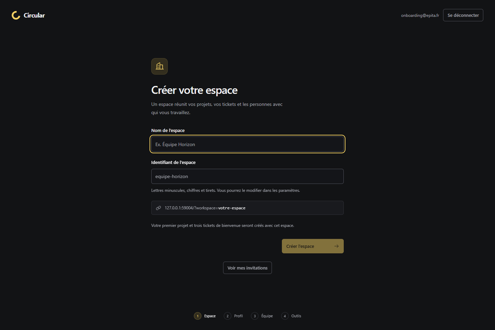
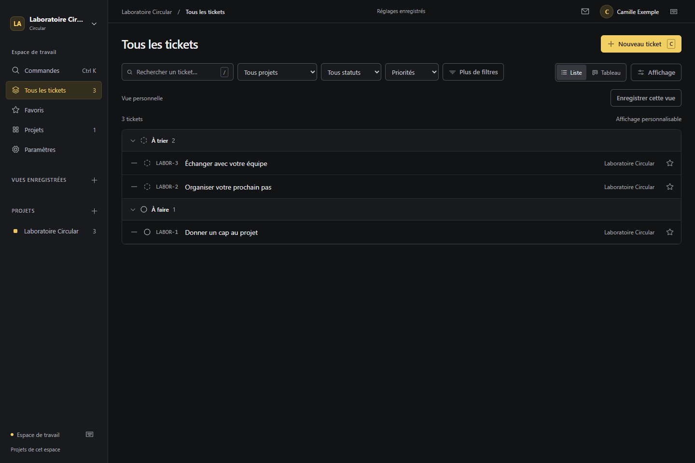
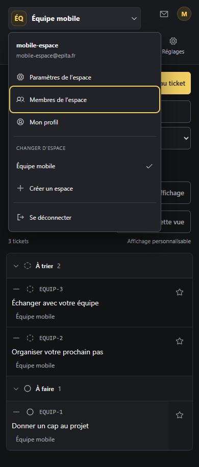

# Validation des espaces et de l’image 2.1

Vérifications exécutées le **28 octobre 2026**, sur Windows avec Docker Desktop Linux, PostgreSQL 17 et Chrome installé. Les tests utilisent des comptes et des données fictifs, sans profil navigateur personnel ni connexion à Linear.

## Résultats

| Contrôle | Résultat observé |
| --- | --- |
| Suite Python complète, SQLite et PostgreSQL | **163 réussis**, aucun ignoré, 61,29 s ; un avertissement de dépréciation Starlette/httpx |
| Build TypeScript et Vite | Réussi ; assets `index-CLY8_7tI.js` et `index-2ac95hBs.css` |
| Suite Playwright Chrome, deux workers | **34 parcours réussis**, 1,4 min ; aucune relance automatique des tests |
| Build Docker final | Image `circular:2.1.0`, ID `sha256:830213ecbc19feaee17c19fff2545977c66ec1d66a4ab8412b1d79ce70e5da67` |
| Correspondance backend image/sources | SHA-256 des 54 fichiers Python/SQL comparés : aucune différence |
| Docker app et PostgreSQL isolés | Démarrage healthy, parcours HTTP avec deux comptes réussis |
| Persistance Docker | Profil, onboarding, tickets, commentaires, statuts et réglages retrouvés après redémarrage app/PostgreSQL |
| Sauvegarde/restauration | `pg_dump -Fc` puis `pg_restore --exit-on-error` dans une autre base ; espaces, membres, réglages et données métier comparés |
| Révocation et suppression | Accès retirés et suppressions conservés après redémarrage |
| Trivy 0.76.1 sur l’image finale complète | **0 HIGH, 0 CRITICAL**, paquets Alpine et Python, sortie 0 ; aucune exclusion de CVE ni de résultats non corrigés |
| Instance locale sur le port 4310 | Mise à jour avec sauvegarde préalable vérifiée ; conteneurs healthy, readiness HTTP 200, nombres de comptes/projets/tickets/commentaires/membres/favoris conservés |

Le correctif du scan de l’ancienne base Debian est expliqué dans [container-security.md](container-security.md). La CI distante construit et scanne le commit de la PR ; son résultat est consultable dans [GitHub Actions](https://github.com/HugoSpy/circular/actions/workflows/container.yml). Ce rapport décrit les exécutions locales, pas un succès distant supposé.

## Couverture des parcours

Les six nouveaux parcours navigateur couvrent la création d’espace, le profil et les étapes facultatives, le premier projet et ses trois tickets, la reprise après actualisation/redémarrage, le changement entre deux espaces avec filtres distincts, les invitations et leur révocation, les liens expirants/révoqués et leur passage par la connexion, ainsi que le menu et les paramètres à 390 px. Les boutons GitHub/Slack affichent leur limitation explicite. Une régression retient une réponse de sauvegarde, déconnecte le compte A, connecte B dans le même espace puis libère la réponse : les modifications encore en file de A ne sont pas envoyées avec la session de B.

Les 28 parcours existants couvrent notamment authentification, projets privés et partage limité, tickets/commentaires, tableau, recherche/filtres, préférences, vues, modèles, étiquettes, raccourcis et liens directs. Les fixtures vérifient aussi l’absence de requêtes externes et d’erreurs JavaScript non gérées.

Les tests API vérifient les limites entre espaces et entre utilisateurs, les identifiants manipulés, les rôles hérités, la migration des anciens accès privés, l’import SQLite vers PostgreSQL et l’attribution explicite des données historiques. Les courses PostgreSQL entre acceptation d’invitation et retrait de membre sont testées dans les deux ordres : pas d’interblocage, pas de rétablissement d’accès par une invitation ciblée antérieure. Les liens partagés encore actifs se révoquent séparément.

Les premiers passages ont détecté un débordement des onglets sur mobile et une sauvegarde de préférences pouvant rester en file après déconnexion ; ces défauts ont été corrigés avant le passage complet. Les tests de paramètres ont été adaptés pour sélectionner explicitement leur section, dont l’onglet actif est désormais conservé.

## Reproduire

Depuis la racine du dépôt, après installation des dépendances selon le README et préparation d’une base PostgreSQL **de test** :

```powershell
$env:CIRCULAR_TEST_POSTGRES_URL_FILE='.test-data/pg-url.txt'
.venv/Scripts/python.exe -m pytest tests -q --basetemp=.test-data/workspace-validation
npm run build
node node_modules/@playwright/test/cli.js test --reporter=list --output=test-results/workspaces
```

Le fichier de connexion reste privé et ignoré par Git. Ne pas exécuter un nouveau build frontend pendant les tests navigateur : ils servent les assets de `dist`.

Pour les parcours Docker, préparer `.test-data/docker.env` et les secrets de test selon le [guide](deployment.md#validation-locale-reproductible), puis :

```powershell
docker compose --env-file .test-data/docker.env -p circular-validation-workspaces -f compose.yaml -f compose.postgres.yaml -f compose.local.yaml up -d --no-build --wait
.venv/Scripts/python.exe scripts/docker-smoke.py --url http://127.0.0.1:14310 --env-file .test-data/docker.env --project circular-validation-workspaces
```

Les cinq groupes retournés par ce script ont réussi : collaboration, onboarding/isolation, redémarrage, sauvegarde/restauration et révocation/suppression.

## Captures issues des tests







## Limites

GitHub et Slack ne sont pas implémentés : leurs écrans « À venir » et leur message au clic sont intentionnels. Aucun email d’invitation/validation ni SSO ; le domaine EPITA ne prouve pas la possession de l’adresse. Les captures Linear fournies servent de référence, sans nouvelle observation de Linear ni copie de ses ressources.

Chrome a été testé en bureau et en viewport mobile ; pas de téléphone physique, Safari ou Firefox. Pas de test de charge à l’échelle de l’école, de déploiement de son reverse proxy HTTPS ni de qualification de sa base distante. Le scan HIGH/CRITICAL daté n’est pas une garantie d’absence de vulnérabilité. La PR ne fusionne ni ne déploie automatiquement l’application à l’école.
